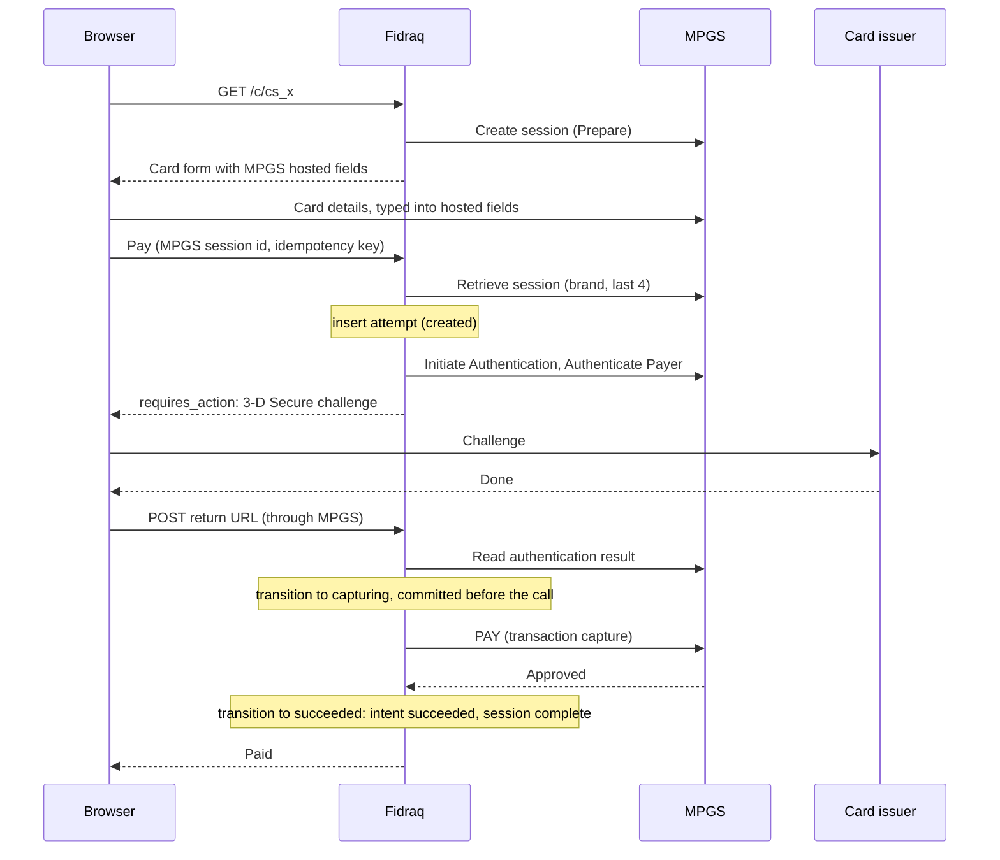
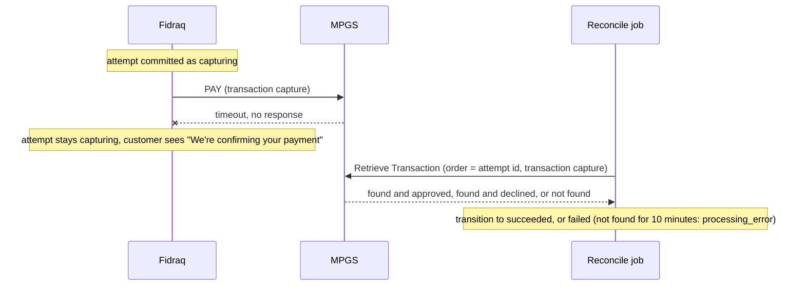

# Payments core v1

Status: draft, frozen for final review. New ideas go to section 10, not into v1.

Scope: the `payments` bounded context in khazina, for the v0.1 release.

In short: a customer pays through a hosted checkout page; Fidraq talks to the merchant's own bank gateway and never holds money. Each payment has one try at a time, and Fidraq writes down "money may be moving" before asking the bank to charge, so even if a call times out or the server crashes, it can always find out what happened and never charges twice. Everything provider-specific stays inside one adapter per gateway, so adding a new provider doesn't touch the core.

## 1. Context

Fidraq is open-source payment software that sits on top of the merchant's own bank gateway (MPGS today). The bank settles money directly to the merchant; Fidraq never holds funds.

The first version of the payments code grew around invoices and around MPGS's 3-D Secure steps. Three problems came out of that:

- Invoices lived inside payments, mixing billing concerns into the money flow.
- The service's public methods were MPGS's steps (`PrepareCardAuthentication`, `AuthenticateCardholder`, ...), so every new provider would force a rewrite.
- Payment logic read the log of gateway calls to find out where a payment was.

This document describes the redesigned core: the data model, the flows, the interfaces, and the decisions behind them.

## 2. Goals and non-goals

Goals for v1:

- One-time payments by card, through a hosted checkout.
- Checkout sessions, also shared as one-time payment requests, and reusable payment links.
- No double charge, ever, including on timeouts, retries, double clicks and races.
- A reconcile job that resolves payments whose outcome is unknown.
- A model where adding a provider (Apple Pay, STC Pay, Benefit, CyberSource, ...) means writing a gateway adapter, not changing the core.

Non-goals for v1 (the core is designed so they are additive later):

- Saved cards, mandates and recurring charges.
- Refunds and voids. Until then merchants use their bank's portal; Fidraq does not see those, so a refunded or voided payment still shows as succeeded.
- Billing (invoices, subscriptions) and integrations such as Zoho.
- Secret API keys for merchants' servers. The Connect endpoints are live in v0.1 for the checkout and the dashboard; API keys, public docs and the promise not to break them come later.
- Routing between several gateways.
- Payment links with a limited number of payments (section 10).

## 3. Vocabulary

| Term | Meaning |
|---|---|
| Account | One merchant business. Has a sandbox and a production environment. |
| Gateway | The merchant's account at a provider (e.g. their MPGS merchant id and credentials). One row in `gateways`. |
| Gateway adapter | Our code for a type of gateway (`mpgs`). `gateways.type` says which adapter handles a gateway. Two banks' MPGS accounts are two gateways and one adapter. |
| Payment intent | What is owed: amount, currency, description, the caller's `external_id`. Paid at most once. |
| Payment attempt | One try to pay an intent with one payment method on one gateway. |
| Gateway request | A log entry for one HTTP call we made to a gateway. |
| Checkout session | The hosted page for one intent: URL, expiry, status. What the customer sees. |
| Payment link | A long-lived, shareable link. Each visit that clicks "Pay" opens a new checkout session. |

## 4. Data model

```
accounts ─ gateways
payment_links ──▶ checkout_sessions ──▶ payment_intents
                                           └─▶ payment_attempts

gateway_requests (log) ──▶ gateways, and when there is one, payment_intents and payment_attempts
```

Every table carries `account_id` and `environment`, and every foreign key between them includes both, so the database itself makes it impossible to mix accounts or to mix sandbox with production.

Enums (Postgres `ENUM`) are used for statuses and fixed types, because these lists only grow and sqlc generates Go types from them: `environment`, `organization_role`, `gateway_type`, `payment_intent_status`, `payment_intent_cancellation_reason`, `checkout_session_status`, `payment_method_type`, `payment_attempt_status`, `payment_attempt_cancellation_reason`, `authentication_method`, `authentication_status`. Open lists stay `VARCHAR`: `currency` (owned by the Go money package), failure codes.

### Payment attempt statuses

Provider-neutral:

| Status | Meaning |
|---|---|
| `created` | The attempt exists; nothing sent yet. |
| `requires_action` | The customer must do something; `next_action` says what. |
| `processing` | Waiting on the provider. |
| `capturing` | Money is moving. |
| `succeeded` | Paid. |
| `failed` | Declined or errored; nothing was charged. |
| `expired` | Time ran out. |
| `canceled` | A decision made it unnecessary; `cancellation_reason` says which. |

The adapter's own step (for MPGS, "waiting for the authentication result") lives in `gateway_data`, not in this enum.

`expired` is the clock (the customer left), `canceled` is a decision, and a gateway call timing out is not an attempt status at all: during capture the attempt simply stays `capturing` until reconcile finds out (5.2). A canceled attempt always has a `cancellation_reason`, enforced by a check constraint:

| Reason | Who decided |
|---|---|
| `merchant_canceled` | The merchant, billing or the API canceled the session or intent. |
| `customer_canceled` | The customer chose to stop, switch method, or take over from another tab or device (5.4). |

`payment_method_type` (`card`, `apple_pay`) is the kind of method an attempt uses. The name `payment_method` is kept free for the saved cards and wallets that come later (a `payment_methods` table, and a `payment_method_id` on attempts saying which one was used).

### Payment intent statuses

The intent mostly follows its attempts; `transition` updates it in the same transaction as the attempt. The only direct moves are canceling it (by the merchant) and expiring it (when its session expires).

| Status | When |
|---|---|
| `requires_payment_method` | No attempt yet, or the last one failed, expired or was canceled. |
| `requires_action` | An attempt is waiting on the customer. |
| `processing` | An attempt is created, processing or capturing. |
| `succeeded` | An attempt succeeded. |
| `canceled` | It will never be paid; `cancellation_reason` says why. |

A canceled intent always has a `cancellation_reason`, enforced by a check constraint. It is stored, not inferred from the attempts:

| Reason | Who decided |
|---|---|
| `merchant_canceled` | The merchant, billing or the API canceled it. |
| `expired` | Its checkout session expired unpaid. The system decided, on the clock, as Stripe's internally generated `expired` reason ([PaymentIntent](https://docs.stripe.com/api/payment_intents/object)). |

### JSON fields on attempts

- `gateway_data`: the adapter's private state between steps, versioned with `"v"`. For MPGS it holds the card-form session id and the 3-D Secure details MPGS returns; ids we can recompute (5.2) are not stored. This is the Memento pattern: the adapter writes and reads it, the core stores and returns it as `json.RawMessage` without looking inside. Rules: anything the core needs comes out as an explicit field instead; no card data or credentials ever go in it; an unknown `v` is a loud error, never a guess.
- `next_action`: what the customer must do now, saved so a reload or a custom UI can show it again. Set when the attempt enters `requires_action`, cleared when it leaves. Like `payment_method_details`, it is a tagged union: the one field that is set is the type, with no separate `type` field, matching a protobuf `oneof`. In Go it is a struct of optional pointers with a `Validate()` (exactly one set) and a `Kind()` helper. v0.1 has one kind:

  ```json
  {"three_d_secure_challenge": {"acs_url": "https://bank.example/acs", "creq": "eyJ...", "html": "<div>...</div>"}}
  ```

  `acs_url` is the issuer's challenge page (the bank's Access Control Server) and `creq` the encoded challenge request to post to it: standard EMV 3-D Secure values, so any gateway can fill them. `html` is the gateway's ready-made snippet that does the same, when it provides one. A client uses either: our hosted checkout renders it in an iframe; a custom UI may use an iframe, a popup or a full-page redirect. Source: [Authenticate Payer](https://credimax.gateway.mastercard.com/api/documentation/apiDocumentation/rest-json/version/100/operation/Authentication%3a%20%20Authenticate%20Payer.html) (`authentication.redirect.html`, `authentication.redirect.customizedHtml.3ds2.acsUrl` and `.cReq`).

  Later kinds are additive: `three_d_secure_device_check` (the invisible 3DS Method HTML that [Initiate Authentication](https://credimax.gateway.mastercard.com/api/documentation/apiDocumentation/rest-json/version/100/operation/Authentication%3a%20%20Initiate%20Authentication.html) returns, which v0 does not render and which helps banks approve without a challenge), `redirect` (Benefit, KNET), `enter_otp` (STC Pay).
- `payment_method_details`: what we show, normalized by the adapter. A typed tagged union shared by everyone: exactly one branch is set, matching `payment_method_type` (`{"card": {"brand", "last4", "exp_month", "exp_year", "funding", "country"}}`, later `{"apple_pay": {...}}`). In the protos it becomes a `oneof`.

Naming: columns of the `gateways` table are not prefixed (`gateways.type`, `gateways.name`); columns elsewhere that refer to a gateway are (`gateway_id`, `gateway_data`).

### Rules the database enforces

- At most one active attempt per intent (`created`, `requires_action`, `processing` or `capturing`): an intent has one try at a time (`idx_payment_attempts_one_active_per_intent`).
- At most one attempt per intent can be `capturing` or `succeeded` (`idx_payment_attempts_one_capture_per_intent`). With one active attempt this already follows, but it stays as a cheap safety net against double charges.
- One active gateway per account and environment (until routing exists), and only a verified gateway (capabilities checked) can be active.
- Currencies are three uppercase letters.
- An attempt has no amount of its own: it always charges its intent's amount and currency, so the two can never disagree.
- Amounts are positive; `succeeded`, `canceled` and `complete` require their timestamps, and an attempt that is `capturing` or `succeeded` has `capturing_at`.
- Idempotency keys are unique per account and environment.
- A gateway request with an attempt also has that attempt's intent (a check and a composite foreign key).

### Indexes

- `payment_intents (account_id, environment, created_at DESC)` serves the dashboard's payments list. On 200,000 rows it ran in 0.1 ms instead of 9.8 ms without it.
- `payment_attempts (capturing_at) WHERE status = 'capturing'` serves the reconcile job. It only holds attempts that are capturing right now, so it stays tiny. The clock is `capturing_at`, set once when the attempt enters `capturing`, not `updated_at`, which any later write would reset.
- `payment_intents (account_id, environment, external_id)` finds a payment by the caller's reference. It is not unique: one order may need several intents (a canceled one, then a new one). With the public API, merchants avoid duplicates with an idempotency key on create.
- `gateway_requests (payment_intent_id, started_at)` and `(gateway_id, started_at)` serve the payment timeline and the gateway's own history.

## 5. Flows

### 5.1 Card payment



1. `GET /c/cs_x`. `CheckoutSessionService.Get` returns the checkout view: merchant name, amount, description, and the methods to offer. Methods come from the active gateway's capabilities (stored in `gateways.capabilities`) filtered by the session's currency. For each method, the adapter's `Prepare` returns what the page needs to render it (for cards: an MPGS session id and the hosted fields script URL). The MPGS call is logged in `gateway_requests`, tagged with the intent. The page renders the card form and the Apple Pay button. No attempt exists.
2. The customer types the card into MPGS hosted fields (card data goes to MPGS, never to us) and clicks Pay, which posts the MPGS session id and an idempotency key. `PaymentIntentService.CreateAttempt`:
   - checks the session is open and the intent is not paid;
   - retrieves the MPGS session from the server: it belongs to this merchant and holds card details (brand, last 4 → `payment_method_details`);
   - inserts the attempt (`created`); the amount comes from the intent, never the browser;
   - calls `adapter.Start(attempt)`: MPGS `INITIATE_AUTHENTICATION` and `AUTHENTICATE_PAYER` (HTTP calls logged automatically, tagged with the attempt);
   - applies the returned step through `transition`: `gateway_data`, `payment_method_details`, and `requires_action` with `next_action` = 3-D Secure challenge. With frictionless 3-D Secure there is no challenge: the step is `processing` with the result, and `CreateAttempt` goes on to step 4 itself.
3. The browser renders the challenge. When the customer finishes, the bank's page posts back (through MPGS) to our return URL, which we give MPGS as `authentication.redirectResponseUrl`: `POST {CHECKOUT_URL}/c/cs_x/attempts/att_y/return`. The endpoint needs no other authentication: it only triggers a fresh read of the result from the gateway, so a forged call cannot change any outcome (5.10). It replies with a tiny page that tells the checkout to refresh the attempt. `PaymentIntentService.ContinueAttempt` → `adapter.Continue` (reads the authentication result) → `transition` → `processing`.
4. Still inside `ContinueAttempt`, once authentication succeeded (no extra browser round trip): `transition` → `capturing`, committed before the call (under the locks in 6.3); `adapter.Capture`: MPGS `PAY` with the deterministic transaction id `capture`; `transition` → `succeeded`: intent succeeded, session complete.

### 5.2 Unknown capture



The PAY call times out. Its request row has no response (`http_status` NULL, `error` set); the attempt stays `capturing`, because it was committed as `capturing` before the call. The customer sees "We're confirming your payment". The one-capture index blocks any other attempt from capturing.

The reconcile job (River, every minute) finds attempts whose `capturing_at` is over a minute old, asks the adapter (`Status`), which finds the payment from the attempt alone, and transitions to `succeeded` or `failed`. If the gateway cannot answer, the attempt stays `capturing` and the job retries with backoff, alerting a person after an hour.

No response before capture (preparing or authenticating) moves no money, so the attempt becomes `failed` and the customer can try again.

The rule that makes this work: **an adapter must be able to reconcile from the attempt alone**, without anything saved before the call.

- MPGS: we choose the ids, so they are deterministic and nothing is saved before the call. The order id is the attempt id; inside that order the authentication transaction is `auth` (both authentication calls share it) and the payment is `capture`. MPGS only requires ids to be unique within an order ([Pay](https://credimax.gateway.mastercard.com/api/documentation/apiDocumentation/rest-json/version/100/operation/Transaction%3a%20%20Pay.html): "Each transaction on the order must have a unique id that identifies that transaction", 1 to 40 characters). Reconcile reads the payment with [Retrieve Transaction](https://credimax.gateway.mastercard.com/api/documentation/apiDocumentation/rest-json/version/100/operation/Transaction%3a%20%20Retrieve%20Transaction.html) (`GET .../order/{orderid}/transaction/{transactionid}`), whose response includes `order.status` and `transaction.type`.
- We never send the same transaction id twice. MPGS's docs do not say what happens if an id is reused, so the design does not depend on it. MPGS also says a failed operation needs a new id for any retry ([Pay](https://credimax.gateway.mastercard.com/api/documentation/apiDocumentation/rest-json/version/100/operation/Transaction%3a%20%20Pay.html): "If you attempt an operation and it fails ..., then you need a new id for each retry"). We never retry inside an attempt: a failed capture fails the attempt, and the customer's next try is a new attempt, which is a new order with fresh ids. After a timeout, reconcile only reads; it never resends.
- Gateways that assign their own ids: we send the attempt id as their merchant reference (CyberSource: `clientReferenceInformation.code`, verified), and reconcile searches by it.

### 5.3 Payment requests and links

A one-time payment request is a checkout session the merchant creates in the dashboard, with a longer expiry if needed, and shares as `/c/cs_...` (for example on WhatsApp). A session has one intent and an intent is paid at most once (section 4), so a request opened by two people is still paid once: they are two tabs on one session (5.4).

A payment link is reusable. `GET /l/plink_x` shows a page with a Pay button and creates nothing (link previews in WhatsApp and other apps must not create sessions). `POST` creates a fresh session and its intent and redirects to `/c/cs_...`. Every customer gets their own session, so links take no part in the money rules and `transition` never touches them.

### 5.4 Two tabs on one session

An intent has one active attempt at a time. When tab B opens the session while tab A's attempt is active, it shows that attempt's screen and "A payment for this is already in progress" (tab A may be another person's phone), with two choices:

- Wait: the page follows the session and shows the result when A's attempt ends.
- Pay here instead: A's attempt is canceled (`customer_canceled`), then B starts its own. Refused while A's attempt is `capturing`, because money is moving; B shows "Confirming your payment..." until it resolves.

If both tabs click Pay at the same moment, the database lets one attempt win; the other `CreateAttempt` gets `ErrConflict` carrying the active attempt, and that tab shows the same screen.

Whoever holds the session URL can take over, so someone with a shared URL could keep interrupting another person's attempt. That is griefing, not a way to move money wrongly (5.10); session URLs are meant for one payer.

### 5.5 Canceling

The merchant (dashboard, API, billing) cancels intents and sessions, never single attempts. Canceling an intent cancels its open attempts in the same transaction, with reason `merchant_canceled`.

Every intent has one owner, and only the owner ends it. An intent created by a checkout session belongs to the session: canceling it directly is refused (`ErrConflict`, "cancel the checkout session instead"), and canceling the session cancels its intent. This is Stripe's rule: "You can't confirm or cancel the PaymentIntent for a Checkout Session. To cancel, expire the Checkout Session instead" ([Checkout Session](https://docs.stripe.com/api/checkout/sessions/object)). An intent created on its own belongs to the merchant, has no clock and stays open until the merchant cancels it.

Canceling is refused while an attempt is `capturing` or after one `succeeded`: a payment that is moving or paid cannot be canceled, only refunded (later). Cancel and capture both lock the intent row, so exactly one of them wins; a caller like billing reads the answer instead of guessing.

### 5.6 Expiry

- Attempts expire 15 minutes after creation, or when their session expires if that is sooner (`expires_at`). The expiry job (River, `ExpireAttempts`) moves open ones (`created`, `requires_action`, `processing`) to `expired`. The services also check `expires_at` on every call, so an attempt past its time is refused even before the job runs. Nobody resets anything by hand.
- Sessions expire after 24 hours by default. A session opened from a link expires at the earlier of 24 hours and the link's `expires_at`. A "request a payment" session can be given a longer expiry.
- When a session expires unpaid, the job moves it to `expired`, cancels its intent with reason `expired`, and expires its open attempts. An attempt that is `capturing` is left to the reconcile job.
- A link refuses new sessions once it is inactive or past its `expires_at`.

### 5.7 Apple Pay

- The button is shown when the device supports Apple Pay and the gateway can take it. No attempt exists.
- When the customer taps it, Apple asks for merchant validation. The browser asks our server, which calls Apple with the merchant identity certificate. The certificate never leaves the server.
- After Face ID or Touch ID, the browser receives the payment token and sends it to our server. That creates the attempt (`payment_method_type = apple_pay`, `authentication_method = device`), and the server sends the token to MPGS.
- The browser talks to our server for everything. The only data that goes straight to MPGS is card numbers typed into hosted fields.

### 5.8 Other outcomes

| Scenario | What happens |
|---|---|
| Card declined | The adapter returns a declined step; the attempt `failed` with a stable `failure_code`; the gateway's raw answer is in the request log. The intent goes back to `requires_payment_method`; the customer can try again with a new attempt. |
| Frictionless 3-D Secure (the bank approves without a challenge) | No `requires_action`: the attempt goes from `processing` straight to `capturing`. |
| Customer fails or cancels the OTP | `authentication_status = failed`, the attempt `failed`. The customer can try another card. |
| Customer closes the tab during 3DS | The attempt expires after 15 minutes (5.6). |
| Customer comes back from the bank after the attempt expired | `ContinueAttempt` refuses it; the page shows the session again so they can retry. |
| Double click on Pay, or a network retry | The same idempotency key returns the same attempt. |
| Session opened after it was paid | The page shows "Paid". No form, no attempt. |
| Session expired or canceled when opened | The page explains it; no form. For a link, opening the link again creates a fresh session. |
| Link inactive or expired | `GET /l/...` shows why and offers no Pay button. |
| Merchant cancels while the customer is on the page | Allowed before capture: the next step is refused and the page shows the session as canceled. Refused during or after capture (5.5). |
| The gateway is down while preparing | That method is shown as unavailable; nothing is created. |
| The gateway is down during authentication | The call gets no response or an error; no money can move before capture, so the attempt `failed` and the customer can retry. |
| The gateway is down during capture | 5.2: the attempt stays `capturing`, reconcile decides. |
| Customer tries a second method after the first failed | A new attempt with the new `payment_method_type`; attempts never change type. |
| Customer tries again with a card after a failed attempt | The checkout prepares a fresh MPGS session and the customer enters the card again. MPGS's [Create Session](https://credimax.gateway.mastercard.com/api/documentation/apiDocumentation/rest-json/version/100/operation/Session%3a%20Create%20Session.html) docs describe a session as temporary storage for request fields but do not say whether it can be reused across orders, so we do not reuse it. Custom UIs do the same by calling Prepare again. |

### 5.9 What the client shows

Any client, our hosted checkout or a merchant's own UI, builds on the same contract: every attempt status has a screen and a way forward.

| Attempt | The customer sees | The customer can |
|---|---|---|
| none yet | the card form and the Apple Pay button | pay |
| `created`, `processing` | "Verifying your card..." | wait |
| `requires_action` | the bank's challenge from `next_action` | complete it, or cancel (the attempt becomes `canceled` with `customer_canceled`) |
| `capturing` | "Confirming your payment...", with no cancel button | wait |
| `succeeded` | the success screen | nothing more |
| `failed` | a message from `failure_code` ("Card declined", "Not enough funds") | try again: a fresh card form and a new attempt |
| `expired`, `canceled` | "This attempt ended" | try again |

A `complete` session shows "Paid"; an `expired` or `canceled` session explains why and shows no form.

- While the attempt is `created`, `processing`, `requires_action` or `capturing`, the page polls `GetAttempt` every two seconds and switches screens when the status changes. While the attempt is `processing`, it also calls `ContinueAttempt` at most every 5 seconds, so a "check later" answer from the gateway is read again (6.8). `GetAttempt` only reads our database; `ContinueAttempt` asks the gateway. Streaming can replace polling later.
- Creating an attempt is refused while another attempt on the intent is active, unless the customer takes over (5.4). Nothing is canceled automatically. `customer_canceled` is set only when a client cancels: the cancel button, switching method in the same tab (cancel the current attempt, then start the new one), or taking over. A closed tab's attempt simply expires.
- The page always shows the intent's active attempt: `CheckoutSessionService.Get` returns it, so any tab, reload or other device opens straight on its screen, and the card form appears only when none is active. Opening never creates an attempt; only Pay does. After creating one, the page puts its id in the URL (`/c/cs_...?attempt=att_...`), so a reload also shows how a finished attempt ended. Attempt ids are random like session ids, so knowing one grants the same limited powers as the session URL (5.10).
- If a saved challenge cannot be shown again (the bank may refuse a second open), the page offers Pay here instead: cancel the attempt and start a new one with a fresh challenge. To be confirmed on the sandbox (section 8).
- If the bank's challenge times out while the page is open, the 3-D Secure standard has the bank send a final "not authenticated" answer back through the iframe, so the attempt fails with `authentication_failed` and the page offers a retry. This comes from the 3-D Secure standard, not MPGS's docs; it is to be confirmed on the sandbox (section 8).

### 5.10 Who can act on a session

The session URL (`/c/cs_...`) is the key, as with Stripe Checkout. Anyone who has it can see the merchant, amount and description, pay it, see a 3-D Secure challenge without being able to pass it, trigger a continue (which only re-reads the result from the gateway) or take over an in-progress attempt that is not capturing (minor griefing; the customer retries). None of this can move money wrongly: the gateway and the database decide every outcome.

Attempts are not tied to the browser that started them. The 3-D Secure return happens inside the bank's iframe, where browsers often block cookies, so a cookie-bound attempt secret would break real payments. The session id and the attempt id in the URL are the keys instead. URLs end up in logs, which is accepted because each id grants only the limited powers above. A stronger secret never goes in a URL: custom UIs built on the API later get a per-intent client secret, passed to their page in code.

## 6. Interfaces

### 6.1 Services

The payments context has one Go package with several services. They share internals (`transition`, queries, gateway adapters) and use plain Go types; protobuf stays at the edge.

```go
type PaymentIntentService interface {
    Create(ctx, CreatePaymentIntentRequest) (*PaymentIntent, error)
    Get(ctx, GetPaymentIntentRequest) (*PaymentIntent, error)
    Cancel(ctx, CancelPaymentIntentRequest) (*PaymentIntent, error)
    List(ctx, ListPaymentIntentsRequest) (*PaymentIntentList, error)        // dashboard payments list
    CreateAttempt(ctx, CreateAttemptRequest) (*Attempt, error)
    GetAttempt(ctx, GetAttemptRequest) (*Attempt, error)                    // the checkout polls it (5.9)
    ContinueAttempt(ctx, ContinueAttemptRequest) (*Attempt, error)
    CancelAttempt(ctx, CancelAttemptRequest) (*Attempt, error)              // the customer's cancel button
    ListAttempts(ctx, ListAttemptsRequest) (*AttemptList, error)            // the payment timeline
    ListGatewayRequests(ctx, ListGatewayRequestsRequest) (*GatewayRequestList, error) // "Debug requests"
}

// Used only by River jobs; never exposed as an RPC.
type PaymentJobs interface {
    ReconcileAttempt(ctx, ReconcileAttemptRequest) (*Attempt, error)
    ExpireAttempts(ctx, ExpireAttemptsRequest) error
    ExpireSessions(ctx, ExpireSessionsRequest) error
}

type CheckoutSessionService interface {
    Create(ctx, CreateCheckoutSessionRequest) (*CheckoutSession, error) // creates the intent too
    Get(ctx, GetCheckoutSessionRequest) (*CheckoutView, error)           // what the page shows, including the active attempt
    Cancel(ctx, CancelCheckoutSessionRequest) (*CheckoutSession, error)
}

type PaymentLinkService interface {
    Create(ctx, CreatePaymentLinkRequest) (*PaymentLink, error)
    Get(ctx, GetPaymentLinkRequest) (*PaymentLink, error)       // the link page and the dashboard
    List(ctx, ListPaymentLinksRequest) (*PaymentLinkList, error)
    Update(ctx, UpdatePaymentLinkRequest) (*PaymentLink, error) // expiry, active
    Open(ctx, OpenPaymentLinkRequest) (*CheckoutSession, error) // the POST from /l/plink_x
}
```

These are Go interfaces with plain Go request and response types. The protos come later and follow the same request/response shape, one RPC per method of the three public services; `PaymentJobs` has no RPC. `GatewayService` (6.10) is a dashboard-only Connect service for now; it may join the public API later, for headless setups. Exact fields are settled while writing the protos.

Every call has a caller, and each method says who may make it:

| Caller | Identified by | May call |
|---|---|---|
| Merchant | a dashboard login (later also an API key) | everything for its own account, except the customer's attempt calls below |
| Customer, holding a session | the session id in the URL (5.10) | `CheckoutSessionService.Get`, and `CreateAttempt`, `GetAttempt`, `ContinueAttempt`, `CancelAttempt` on that session's intent |
| Anyone with a link | the link id in the URL | `PaymentLinkService.Get` (the public page) and `Open` |
| River jobs | running inside the server | `PaymentJobs` |

`CancelAttempt` is the customer's button only; merchants cancel intents and sessions (5.5).

The hosted checkout uses these services the way a merchant's own UI would: no private methods exist for it.

### 6.2 Gateway adapter

```go
type GatewayAdapter interface {
    Prepare(ctx context.Context, intent Intent, method MethodType) (ClientConfig, error) // render a method before any attempt
    Start(ctx context.Context, a Attempt, in StartInput) (Step, error)
    Continue(ctx context.Context, a Attempt, in ContinueInput) (Step, error)
    Capture(ctx context.Context, a Attempt) (Step, error)
    Status(ctx context.Context, a Attempt) (Step, error) // reconcile
}

type Step struct {
    Status               AttemptStatus
    NextAction           *NextAction
    GatewayData          json.RawMessage
    PaymentMethodDetails *PaymentMethodDetails
    Authentication       *Authentication // method, status, eci, liability shift
    Failure              *Failure        // our failure code and the gateway's raw code
}
```

- Adapters never touch the database. They make their HTTP calls and return a step; the service applies it through `transition`.
- Adapters are plain calls. The earlier design returned prepared commands (thunks) so the service could log each call and save its transaction id before sending. Both reasons are gone: the HTTP transport logs every call, and ids are deterministic or searchable (5.2).
- Before `Capture`, the service commits the attempt as `capturing`. No database transaction is ever held open across a gateway call; a 30-second call would hold row locks for 30 seconds.
- A step with status `capturing` means "ready to charge". Whichever call returned it (`Start` for frictionless 3-D Secure or Apple Pay, `Continue` after a challenge), the core runs the same internal capture: `transition` to `capturing`, then `adapter.Capture`, then `transition` to the result. An adapter never sends a money call from `Start` or `Continue`. Methods with no customer step in between, like Apple Pay, never call `Continue`.
- Only the call whose move to `capturing` won may call `Capture`. The row lock lets exactly one win, so a second return POST finds the attempt already `capturing` and only reads it.
- `Capture` runs with `context.WithoutCancel`, so a customer closing the tab never aborts a PAY in flight. A crash during the call is covered by reconcile (5.2).

**Request logging.** Every adapter's HTTP client is wrapped in a recording transport (an `http.RoundTripper`). It writes a `gateway_requests` row before sending and finishes it after, tagged with the gateway, intent and attempt carried in the request context.

Headers are never logged: the MPGS API password travels in the `Authorization` header. Bodies are stored as they are for now; with hosted fields they contain no full card numbers. Body redaction is added when an adapter needs it; the adapter supplies it, because only it knows which fields of its payloads are sensitive.

The log fails open: if writing a row fails, the request is still sent and the failure goes to application logs. The log is observability, never what keeps money safe; the attempt state and the deterministic ids are. Each log write has a short timeout so a slow database cannot slow payments down.

### 6.3 Transition

One function in the payments package is the only code that writes attempt, intent and session status. It runs in one database transaction, locks rows in a fixed order (intent, then session, then attempts) so two transitions can never deadlock, validates the move, sets the fields below, and (later) writes outbox events. HTTP handlers, River jobs and provider callbacks all reach it through the services.

How it is safe under concurrency: Postgres runs at its default isolation level (read committed), and `transition` takes row locks with `SELECT ... FOR UPDATE` in the fixed order above before reading the state it changes. Every path follows that order, including canceling and expiring a session: they read the session's intent id first (it never changes) and lock the intent before the session. The partial unique indexes back this up: even if two transactions raced, the database itself refuses a second capture.

Time always comes from the database (`NOW()`), never from the server's clock, so expiry checks agree across all running pods.

Every update query sets `updated_at = NOW()` itself; there are no triggers.

**Attempt** (the source of truth):

| From | To | When | Fields set |
|---|---|---|---|
| `created` | `requires_action` | 3-D Secure needs a challenge | `next_action`, `gateway_data`, `payment_method_details` |
| `created` | `processing` | frictionless 3-D Secure, or waiting for the result | `gateway_data`, `payment_method_details` |
| `created` | `capturing` | a method with no authentication step (Apple Pay) | `authentication_method = device`, `payment_method_details`, `capturing_at` |
| `created`, `requires_action`, `processing` | `failed` | declined or errored before capture | `failure_code`, authentication fields if known |
| `requires_action` | `processing` | the customer came back from the bank | `next_action = NULL` |
| `created`, `requires_action`, `processing` | `expired` | `expires_at` passed, or its session expired | `next_action = NULL` |
| `processing` | `capturing` | authenticated | `authentication_method`, `authentication_status`, `eci`, `liability_shift`, `capturing_at` |
| `created`, `requires_action`, `processing` | `canceled` | the merchant or the customer | `cancellation_reason`, `next_action = NULL` |
| `capturing` | `succeeded` | approved | |
| `capturing` | `failed` | a definite decline, or reconcile found nothing at the gateway more than 10 minutes after `capturing_at` (6.7) | `failure_code` |
| `succeeded`, `failed`, `expired`, `canceled` | none | final | |

`capturing` is never canceled or expired; only the gateway's answer ends it.

**Side effects in the same transaction:**

- Into `succeeded`: the intent becomes `succeeded` (`succeeded_at`) and the session `complete` (`completed_at`). There are no other open attempts to cancel.
- After every move, the intent's status follows its one active attempt. This is Stripe's model ([PaymentIntent lifecycle](https://docs.stripe.com/payments/paymentintents/lifecycle)): "If the payment attempt fails (for example, due to a decline), the PaymentIntent's status returns to `requires_payment_method` so that the payment can be retried."

  | Active attempt | Intent |
  |---|---|
  | none (no attempt yet, or the last one failed, expired or was canceled) | `requires_payment_method` |
  | `created`, `processing`, `capturing` | `processing` |
  | `requires_action` | `requires_action` |
  | it `succeeded` | `succeeded` |

  `succeeded` and `canceled` are the intent's own decisions and final; the statuses in between mirror the current attempt. The intent's status is stored because the payments list filters on it, and only `transition` writes it.

**Intent:** derived as above. How it ends:

| To | When | Fields set |
|---|---|---|
| `succeeded` | its attempt succeeded | `succeeded_at` |
| `canceled` | the merchant canceled it; refused if an attempt is capturing or succeeded. Open attempts are canceled with `merchant_canceled`. | `canceled_at`, `cancellation_reason = merchant_canceled` |
| `canceled` | its session expired unpaid; skipped while an attempt is capturing | `canceled_at`, `cancellation_reason = expired` |

**Checkout session:**

| From | To | When | Fields set |
|---|---|---|---|
| `open` | `complete` | its intent succeeded | `completed_at` |
| `open` | `expired` | `expires_at` passed and no attempt is capturing | |
| `open` | `canceled` | the merchant canceled it (only merchants cancel sessions, so there is no reason column); same rules as canceling the intent | `canceled_at` |

### 6.3.1 Failure codes

Our own stable codes, part of the public API: few, snake_case, and only ever added, never renamed. They are Go constants stored as `VARCHAR`. The gateway's raw code is not stored on the attempt; it is in the request log's response body, shown in the dashboard's "Debug requests" section.

| Code | Meaning |
|---|---|
| `card_declined` | The bank declined, with no more specific reason. |
| `insufficient_funds` | Not enough money on the card. |
| `expired_card` | The card has expired. |
| `incorrect_cvc` | Wrong security code. |
| `authentication_failed` | The customer failed or did not complete 3-D Secure. |
| `authentication_unavailable` | 3-D Secure could not run for this card. |
| `blocked` | Blocked by risk or fraud rules. |
| `customer_aborted` | The customer aborted at the bank or gateway. |
| `card_not_supported` | The card type or method is not enabled for this merchant. |
| `retry_limit_exceeded` | Too many tries with this card. |
| `processing_error` | Something failed on our side or the gateway's, and nothing was charged. |

### 6.4 Public API

- The public API is ConnectRPC: plain HTTP with JSON (callable with curl), plus gRPC and gRPC-Web from the same handlers. Protos are the single source of truth for the server, the TypeScript and Go clients, and the docs.
- Protos live in `fidraq.payments.v1`, with one service per resource: `PaymentIntentService`, `CheckoutSessionService`, `PaymentLinkService`. They carry `google.api.http` annotations from the start (for example `get: "/v1/payment_intents/{id}"`), which keeps the design resource-oriented.
- Later, Vanguard serves the same handlers as REST from those annotations, and an OpenAPI spec is generated from the protos. Secret API keys, rate limits, `buf breaking` in CI and the public docs come with the launch, after v0.1.
- The Connect endpoints are live in v0.1 for two callers: the checkout (by session id) and the dashboard (by login). The launch adds secret API keys for merchants' servers on the same endpoints, plus public docs and the promise not to break them. Until then the protos may change.
- The hosted checkout is a client of the same services, like a merchant's own UI would be. Its small script calls the Connect endpoints with plain `fetch`, using the session id from the URL, which can only touch its own session (5.10). The script calls the API on its own domain (`CHECKOUT_URL`), so Fidraq sends no CORS headers, and browsers block other websites' scripts from calling it. Anyone can still call it outside a browser; the session id's limited powers are what keep that safe.
- Checkout pages live on one domain set by `CHECKOUT_URL` (for example `checkout.fidraq.com`), at `/c/cs_...` and `/l/plink_...`. The old per-merchant custom domains (the tenant-by-host middleware) are removed in v1. Because sessions and links are found by their global ids, custom domains can return later as a mapping from host to account, without changing URLs or ids; the README no longer advertises them.
- Session and attempt ids are keys (5.10), which only works because they are random UUIDs (version 4, from `gen_random_uuid()`). They must never become time-ordered UUIDs (version 7), which would make URLs guessable.
- Public ids are a prefix plus the UUID encoded in base62 (22 characters), for example `pi_7n42DGM5Tflk9n8mt7Fhc7`: `pi_` (intents), `cs_` (sessions), `plink_` (links), `att_` (attempts). The database stores plain UUIDs; encoding and decoding happen only at the edges. They are fixed before checkout URLs ship, because URLs cannot change afterwards.
- Idempotency keys travel in an `Idempotency-Key` HTTP header; the transport passes the key to the service as a parameter. In v0.1 only attempt creation needs one (from the checkout): a repeated key returns the stored attempt if it is for the same intent and payment method, and `ErrIdempotencyMismatch` otherwise. With the public API, creating intents, sessions and links accepts one too, backed by a request-level `idempotency_keys` table (key, request hash, stored response); calls between contexts (6.5) rely on it.
- Money in the API is a decimal string plus a currency (`"150.00"`, `"SAR"`). In Go it is always `money.MinorAmount` and `money.Currency`.

### 6.5 Boundaries

Fidraq is a modular monolith: one binary made of bounded contexts. Payments is the core context; identity (users, organizations, login) is generic; billing arrives later as a supporting context.

Inside payments the layers follow ports and adapters:

- Driving adapters call in: Connect handlers, the templ checkout, River jobs and, later, provider callbacks. They map their world (proto, HTTP forms) to Go types and call a service.
- The services are the primary ports. They use plain Go types and never import protobuf.
- The core is `transition`, the money rules and the gateway adapter interface.
- Driven adapters are the gateway adapters (MPGS today) and Postgres through sqlc. Payments uses sqlc directly rather than a repository layer, because some money rules live in Postgres on purpose.

Rules between contexts:

1. A context calls another only through its public service interface, never its tables.
2. Dependencies point one way. Billing may call payments; payments never calls billing. Payments reports what happened through events (a transactional outbox, added with webhooks), and other contexts react to them.
3. No cycles, enforced with a lint rule on imports.
4. Calls between contexts never share a database transaction and always carry an idempotency key, as if the other context were remote.
5. Workflows that cross contexts (an invoice waiting to be paid) are sagas owned by the calling context, built from River jobs, events and idempotency keys.

Inside one context, services share internals freely.

### 6.6 Code structure

One package per bounded context. Inside payments, a shared core holds the dangerous parts, and thin structs per resource are the doors:

```
internal/payments/
  core.go         core: db, queries, gateway adapters, transition() (unexported)
  payments.go     New(...) *Payments, which builds the core once and every door on it
  intents.go      Intents   → PaymentIntentService
  sessions.go     Sessions  → CheckoutSessionService
  links.go        Links     → PaymentLinkService
  jobs.go         Jobs      → PaymentJobs (River workers only)
  gateways.go     Gateways  → GatewayService (the dashboard)
  interfaces.go   the service interfaces (mocks are generated from them)
  adapter.go      the GatewayAdapter interface, Step, and the recording transport
  mpgs/           the MPGS adapter
```

```go
type Payments struct {
    Intents  *Intents
    Sessions *Sessions
    Links    *Links
    Gateways *Gateways
    Jobs     *Jobs
}

func New(db *pgxpool.Pool, q *store.Queries, gr GatewayResolver) *Payments {
    c := &core{db: db, queries: q, gateways: gr}
    return &Payments{Intents: &Intents{c}, Sessions: &Sessions{c}, Links: &Links{c}, Gateways: &Gateways{c}, Jobs: &Jobs{c}}
}
```

- Accept interfaces, return structs: `New` returns concrete types; every caller holds only the interface it needs (interface segregation). The checkout handler holds `PaymentIntentService` and `CheckoutSessionService`; River workers hold `PaymentJobs`.
- `server/dependencies.go` is the composition root: everything is built there once and handed out. Dependency injection is manual, without a framework.
- Every door goes through the same core, so transactions and `transition` exist in one place only.
- Other contexts follow the same shape: `identity.New(...)` with `Auth` and `Organizations`; later `billing.New(...)` with `Invoices`, `Subscriptions` and `Jobs`.

### 6.7 MPGS capture mapping

How the MPGS adapter turns a PAY response into a step. Every PAY request sets `order.acceptPartialAmount` to `false` ([Pay](https://credimax.gateway.mastercard.com/api/documentation/apiDocumentation/rest-json/version/100/operation/Transaction%3a%20%20Pay.html)), so a payment is either approved for the full amount or rejected; there is no partial state.

 Values from the official [Pay](https://credimax.gateway.mastercard.com/api/documentation/apiDocumentation/rest-json/version/100/operation/Transaction%3a%20%20Pay.html) docs: `result` is one of `SUCCESS`, `FAILURE`, `PENDING`, `UNKNOWN` (and `ERROR` for rejected requests); `response.gatewayCode` summarizes the outcome; `response.gatewayRecommendation` says what to do next. The working v0 code was used as evidence of real Credimax behavior, not as the design: this table is built from the docs and corrects v0 where they disagree (approval variants and partial approvals).

Before trusting any response, the adapter checks that it matches the request: order id, transaction id, transaction type `PAYMENT`, amount and currency. A mismatch is treated as unknown and alerts.

| MPGS response | Attempt | Notes |
|---|---|---|
| `SUCCESS` + `APPROVED` | `succeeded` | |
| `SUCCESS` + `APPROVED_PENDING_SETTLEMENT` or `APPROVED_AUTO` | `succeeded` | Both are approvals in the docs ("Transaction Approved - pending batch settlement", "automatically approved by the gateway"). |
| `FAILURE` + `DECLINED`, `REFERRED`, `DECLINED_DO_NOT_CONTACT` | `failed`, `card_declined` | |
| `FAILURE` + `INSUFFICIENT_FUNDS` | `failed`, `insufficient_funds` | |
| `FAILURE` + `EXPIRED_CARD` | `failed`, `expired_card` | |
| `FAILURE` + `INVALID_CSC`, `DECLINED_CSC` | `failed`, `incorrect_cvc` | |
| `FAILURE` + `AUTHENTICATION_FAILED`, `NOT_ENROLLED_3D_SECURE` | `failed`, `authentication_failed` | |
| `FAILURE` + `BLOCKED` | `failed`, `blocked` | Risk or 3-D Secure blocking rules. |
| `FAILURE` + `ABORTED`, `CANCELLED` | `failed`, `customer_aborted` | |
| `FAILURE` + `EXCEEDED_RETRY_LIMIT` | `failed`, `retry_limit_exceeded` | |
| `FAILURE` + `NOT_SUPPORTED` | `failed`, `card_not_supported` | |
| `FAILURE` + `DECLINED_AVS`, `DECLINED_AVS_CSC`, `DECLINED_PAYMENT_PLAN`, `DECLINED_PIN_REQUIRED`, `DECLINED_INVALID_PIN` | `failed`, `card_declined` | Rare for online card payments. |
| `FAILURE` + `LOCK_FAILURE` | stays `capturing` | "Order locked - another transaction is in progress for this order". The order is this attempt, so something is happening on it and the outcome is unknown; reconcile decides. We never resend. |
| `PARTIALLY_APPROVED` | stays `capturing`, alert | Should never happen: every PAY sends `order.acceptPartialAmount: false`, and the docs say that without it "the transaction will be rejected" when the full amount is not available. If it arrives anyway, money may have moved for a lesser amount, so a person checks it. |
| `PENDING`, `UNKNOWN`, or codes `SUBMITTED`, `PENDING`, `TIMED_OUT`, `UNKNOWN`, `ACQUIRER_SYSTEM_ERROR`, `SYSTEM_ERROR` | stays `capturing` | Reconcile decides (5.2). |
| `ERROR` with cause `INVALID_REQUEST` | `failed`, `processing_error` | The request was rejected and not processed; it is our bug, so it also alerts. |
| `ERROR` with cause `SERVER_BUSY`, `SERVER_FAILED`, `REQUEST_REJECTED` | stays `capturing` | Not documented as "nothing happened", so it is treated as unknown. |
| No response (timeout, connection reset) | stays `capturing` | 5.2. |

**Reconcile.** The job is generic: it finds attempts whose `capturing_at` is over a minute old and calls the adapter's `Status`. The logic is per gateway, inside the adapter. For MPGS, `Status` calls [Retrieve Transaction](https://credimax.gateway.mastercard.com/api/documentation/apiDocumentation/rest-json/version/100/operation/Transaction%3a%20%20Retrieve%20Transaction.html) for transaction `capture` in order `<attempt id>`, checks it matches the attempt, and maps it with the same table. If the answer is still uncertain, the attempt stays `capturing`, the job retries with backoff, and after an hour it alerts a person.

**Not found.** MPGS answers a missing transaction with HTTP 400 and `{"result": "ERROR", "error": {"cause": "INVALID_REQUEST", "explanation": "Unable to find order <order> and transaction <transaction> for merchant <merchant>"}}` (confirmed on the Credimax sandbox; `khazina/internal/clients/mpgs/hurl/retrieve-transaction.hurl` repeats the check). `INVALID_REQUEST` also means a malformed request, so this reading is only used for our own retrieve call; anything else unexpected alerts instead of guessing.

Not found is not final at once, because a PAY can still land after our call gave up. It is final only when `capturing_at` is more than 10 minutes old; then the attempt is `failed` with `processing_error`. The clock is `capturing_at`, not the request log, which fails open. The PAY call's HTTP timeout (30 seconds) must stay far below this window.

Failing it is still a bet, so it is checked twice more. In the same transaction ([transactional enqueueing](https://riverqueue.com/docs/transactional-enqueueing)), reconcile schedules two River jobs, an hour and a day later ([scheduled jobs](https://riverqueue.com/docs/scheduled-jobs)), that read the capture again. If it turns up, they alert; they never change the attempt themselves, and a person handles it.

### 6.8 MPGS authentication mapping

Authentication uses [Initiate Authentication](https://credimax.gateway.mastercard.com/api/documentation/apiDocumentation/rest-json/version/100/operation/Authentication%3a%20%20Initiate%20Authentication.html) and then [Authenticate Payer](https://credimax.gateway.mastercard.com/api/documentation/apiDocumentation/rest-json/version/100/operation/Authentication%3a%20%20Authenticate%20Payer.html), which must use "the same orderId and transactionId submitted on the Initiate Authentication operation" (the shared `auth` transaction). The adapter reads `response.gatewayRecommendation` and `transaction.authenticationStatus`:

| MPGS | Step |
|---|---|
| Initiate: `PROCEED` and `AUTHENTICATION_AVAILABLE` | call Authenticate Payer |
| `AUTHENTICATION_PENDING` with challenge data | `requires_action` with `three_d_secure_challenge` |
| `AUTHENTICATION_SUCCESSFUL` | `authentication_status = authenticated`, then capture |
| `AUTHENTICATION_ATTEMPTED` | `authentication_status = attempted`, then capture |
| `AUTHENTICATION_FAILED`, `AUTHENTICATION_REJECTED` | `failed`, `authentication_failed` (the docs: "You should not proceed with this transaction") |
| recommendation `DO_NOT_PROCEED` or `DO_NOT_PROCEED_ABANDON_ORDER` | `failed`, `card_declined` |
| recommendation `CHECK_TRANSACTION_STATUS_LATER` | stays `processing`; the checkout calls `ContinueAttempt` again while it polls (5.9). If the tab is closed, the attempt expires; no money has moved. |
| `AUTHENTICATION_EXEMPT` | capture with `liability_shift = false`: an exemption from 3-D Secure was granted, so the merchant keeps the fraud liability. Rare outside Europe. |
| `AUTHENTICATION_UNAVAILABLE` | `failed`, `authentication_unavailable`: 3-D Secure could not run, so no payment goes through unprotected. This is a business decision: it gives up some sales, often on foreign cards, so the merchant never carries the fraud liability. A per-merchant setting to accept these can come later. |
| `AUTHENTICATION_NOT_SUPPORTED` | `failed`, `authentication_unavailable`, for the same reason. |

### 6.9 Errors

An alert in v0.1 is an error-level log line with a fixed `alert` field and the ids involved (for example `alert=capture_unresolved attempt=att_...`), so any log tool can notify on it. Alerts fire for: an attempt `capturing` for over an hour, a capture that turns up after its attempt failed (6.7), a gateway response that does not match its request, `PARTIALLY_APPROVED`, an unexpected `ERROR` from MPGS, and internal errors.

Roles exist in the schema but are not enforced in v0.1: every team member sees everything, including "Debug requests". When roles are enforced, raw requests become admin-only.

A payment decline is not an error: `CreateAttempt` returns the attempt as `failed` with its failure code. Errors mean the request itself did not work.

When `CreateAttempt` is refused because another attempt is active, the `ErrConflict` carries that attempt, so the client can show it without another call. Stripe's errors do the same with the `payment_intent` they concern ([Errors](https://docs.stripe.com/api/errors)).

| Service error | Connect code | HTTP | Example |
|---|---|---|---|
| `ErrInvalid` | `invalid_argument` | 400 | bad amount, unknown currency |
| `ErrNotFound` | `not_found` | 404 | unknown id; also used for another account's or environment's ids, so nothing leaks |
| `ErrConflict` | `failed_precondition` | 409 | already paid, session expired or canceled, cancel while capturing, canceling a session's intent directly |
| `ErrIdempotencyMismatch` | `already_exists` | 409 | the same idempotency key with a different request |
| `ErrUnauthenticated` | `unauthenticated` | 401 | |
| `ErrGateway` | `unavailable` | 503 | the gateway is down before anything was charged |
| anything else | `internal` | 500 | our bug; it alerts |

### 6.10 Gateway service

A fifth door in the payments context (`gateways.go`), used by the dashboard to connect a merchant's gateway.

```go
type GatewayService interface {
    Create(ctx, CreateGatewayRequest) (*Gateway, error)     // name, type, config, credentials
    Get(ctx, GetGatewayRequest) (*Gateway, error)
    List(ctx, ListGatewaysRequest) (*GatewayList, error)
    Update(ctx, UpdateGatewayRequest) (*Gateway, error)      // rename, or rotate the password (re-verified)
    Activate(ctx, ActivateGatewayRequest) (*Gateway, error)
    Deactivate(ctx, DeactivateGatewayRequest) (*Gateway, error)
    Delete(ctx, DeleteGatewayRequest) error                  // soft delete
    RefreshCapabilities(ctx, RefreshCapabilitiesRequest) (*Gateway, error)
}
```

The adapter gets one more method, used only here: `Capabilities(ctx, gateway) (Capabilities, error)`; for MPGS it calls Payment Options Inquiry.

Connecting a gateway:

1. The merchant enters a name, the MPGS host (for example `credimax.gateway.mastercard.com`), the merchant id and the API password.
2. The gateway is saved inactive, with the password encrypted. It needs an id so its verification call is logged in `gateway_requests` like any other gateway-level call.
3. Verification calls `Capabilities` with API version 100. A wrong password, a wrong host or a bank that does not support version 100 gives a clear error and the gateway stays inactive. Success stores `capabilities` and `capabilities_checked_at`.
4. Activation, if no other gateway is active in that environment.

Rules that keep payments in flight safe:

- An attempt always uses its own gateway (`attempt.gateway_id`). Activating, deactivating or deleting a gateway only changes which gateway new attempts use; an attempt in 3-D Secure or capturing finishes on its gateway, and reconcile still finds it.
- A gateway's identity never changes: its type, host and merchant id are fixed. A different MPGS merchant is a new gateway. Only the password can be rotated, and rotating it verifies again.
- Only a verified gateway can be active (a check constraint).
- Delete is soft: the row stays, so history and attempts in flight still resolve it.
- The password is never returned by the API (only whether it is set) and never logged (headers are not logged). It is encrypted with AES-GCM, with a key version at the start of the stored value so the encryption key can be rotated later. The key is the `ENCRYPTION_KEY` setting (base64, required at startup).

Capabilities are refreshed by a daily job and by a "refresh" button.

## 7. Alternatives considered

**Event-driven core.** Attempts would advance by publishing and consuming events. Decoupled and auditable, but capture needs strong consistency at that moment (row locks, the one-capture index, write-ahead), and an event bus makes those eventually consistent, adding ordering and duplicate problems exactly where a mistake charges twice. Chosen instead: a synchronous state machine for money and a transactional outbox for everything that reacts to money (webhooks, billing, Zoho). Revisit if the core is split across services.

**Microservices.** Separate services for checkout, payments and gateway adapters. Independent deploys, but network calls, no shared transactions, harder debugging, and self-hosters would run several services. Chosen instead: a modular monolith (one binary, bounded contexts as Go packages, dependencies in one direction).

**Card-specific attempt statuses** (`ready_to_authenticate`, `awaiting_authentication_result`, `ready_to_capture`). Precise for MPGS, but baked one provider's flow into an enum that is hard to change. Chosen instead: neutral statuses plus `next_action` and adapter-owned `gateway_data`.

**A `gateway_reference` column.** MPGS lets us choose the order id, so the attempt id is the order id and nothing needs storing. Gateways that assign their own ids (CyberSource) store them in `gateway_data`; a column is added only if we need to search by it.

**VARCHAR with CHECK constraints for statuses.** Easy to change, but the list lives in two places (SQL and hand-written Go constants). Chosen instead: Postgres enums, where sqlc generates the Go types; removing values is hard, but statuses only grow.

**Logic reading the log.** The old code found the previous step's reference in the log of gateway calls. The attempt now holds the state; the log is for people and disputes.

**A business-level operations log** (operation type, transaction id, succeeded/declined/unknown per call). Every field chosen dragged a gateway concept into the core, and not every gateway has a transaction id per call. Chosen instead: an HTTP-level request log written by the transport, with no business fields; the business outcome lives on the attempt.

**Random transaction ids saved before each call.** Safe if saved in the same commit that sets `capturing`, but one more thing to get right. Deterministic ids need nothing saved.

**Prepared commands (thunks) for gateway calls.** They let the service log and save ids before sending. Replaced by transport logging plus deterministic or searchable ids, which keep the same safety with less machinery.

**One name per role: "gateway" and "connector".** Two nouns for nearly one thing. Chosen instead: "gateway" everywhere in data and API (merchants say "payment gateway"; Spreedly uses it for every provider), and "gateway adapter" for the code.

**Parallel attempts per intent.** Several attempts could be open at once (two tabs both in 3-D Secure), and the intent's status would be a summary of them, with a priority rule and a `superseded` cancel when one succeeded. It handled an edge case nobody needs and was more complex than Stripe, whose intent has one try at a time. Chosen instead: one active attempt per intent, enforced by a unique index, with an explicit take-over for a second window.

**One links table with `max_payments` for one-time and reusable links.** One table covered both, but the limit had to be checked as a capture starts, under a lock on the link, which put links inside `transition` and needed a race of its own. Chosen instead: a one-time request is a checkout session, which already pays at most once, and links are reusable with no limit.

**Postgres schemas per bounded context.** Visible ownership and database-level permissions, but there is only one real context today and per-test schemas already use `search_path`. Revisit when billing arrives; moving tables is `ALTER TABLE ... SET SCHEMA`.

## 8. Risks and open questions

Every external fact this design relies on must come from the provider's official documentation, with a link. Anything not yet checked is marked unverified and is not built on until it is.

Facts already checked are stated where the design uses them, with their links (5.2, 5.8, 6.7, 6.8). This section lists only what is still open.

Before the MPGS adapter (rollout step 3), on the Credimax sandbox:

- Wait out a 3-D Secure challenge and check that a final "not authenticated" answer comes back (5.9).
- Pay with a card that passes 3-D Secure without a challenge and record what Authenticate Payer returns, to confirm the frictionless row of 6.8.
- Reload during a 3-D Secure challenge and check that the saved challenge can be shown again (5.9).

Accepted, handled by the design:

- Bank-hosted MPGS instances may not support API version 100; the gateway's verification checks it on connect (6.10).
- The gateway itself unavailable for a long time: attempts stay `capturing`, reconcile retries with backoff and alerts a person after an hour (6.7).
- Exact request and response shapes are settled with the protos (rollout step 5).
- Refunds and voids done in the bank's portal are invisible to Fidraq in v0.1: the payment still shows as succeeded. Refunds in Fidraq (section 10) fix this.

Later, before the feature that needs them:

- Apple Pay (v0.1.1): merchant certificates and domain verification; whether each bank enables wallets on the merchant's MID.
- Co-badged cards (mada, Benefit with Visa or Mastercard): which network is used is often decided by the acquirer; the checkout may need separate buttons for local networks.
- Unverified: how Benefit, KNET, BenefitPay and STC Pay work. Everything said about them in section 10 is general knowledge and must be checked against their official docs before any adapter is designed.
- PCI DSS: card data only ever enters the gateway's hosted fields, which keeps scope small but not zero. Hosted Fidraq serves the page around those fields, so it is a service provider (at Visa Level 2, under 300,000 transactions a year: a yearly SAQ D for service providers and quarterly ASV scans); merchants using it fill SAQ A, whose v4.0.1 eligibility asks that their pages are protected against script attacks ([PCI SSC FAQ](https://pcisecuritystandards.org/faq/articles/Frequently_Asked_Question/how-does-an-e-commerce-merchant-meet-the-saq-a-eligibility-criteria-for-scripts)). Unverified against the official SAQ documents; read them and ask Credimax what they require before hosted Fidraq or `fidraq.js` goes live. PCI SSC forbids claiming "PCI compliant" or showing compliance logos ([FAQ](https://www.pcisecuritystandards.org/faq/articles/Frequently_Asked_Question/Does-PCI-SSC-provide-a-PCI-DSS-Compliant-logo)); the proof is an Attestation of Compliance shared on request.

## 9. Rollout

Migrations run as their own step (`khazina migrate`), as a Kubernetes job or Helm hook before a new version rolls out, not when the server starts, so several pods never race to migrate. In development `mise run dev` still runs it automatically. River's own tables are installed with River's migrator (`rivermigrate`) in the same step. River tracks its migrations in its own `river_migration` table, separate from ours, so the two never interfere ([River migrations](https://riverqueue.com/docs/migrations)). River supports a separate Postgres schema, but it stays in the default schema with everything else.

Adding an enum value (`ALTER TYPE ... ADD VALUE`) and the first use of that value go in separate migrations: Postgres does not allow a new value to be used in the transaction that added it ([ALTER TYPE](https://www.postgresql.org/docs/current/sql-altertype.html)).

`main` keeps the old system working and serves as the reference and demo. The rewrite happens on `schema-redesign` in small commits, each building and passing its own tests; old code is deleted as new code replaces it. The branch merges when the end-to-end tests pass again.

The design ships in two releases. v0.1.0 is everything here except Apple Pay (5.7), which waits on Apple's merchant certificates and the bank enabling wallets on the merchant's MID (section 8). v0.1.1 adds Apple Pay in its own pull request, from this same design.

1. Schema
2. Queries and sqlc
3. Gateway adapter interface, the recording transport and the MPGS adapter, plus the gateway service (connect, verify, activate)
4. `transition` and the money-safety tests (two captures racing, two tabs on one session)
5. Services
6. Checkout pages (templ, one component per action) and prefixed public ids
7. River: reconcile with its later re-checks, expiry, and the daily capabilities refresh
8. Dashboard: payments list and detail, payment requests, links, gateway setup
9. End-to-end tests: update the existing three, add declined, failed OTP, link, two tabs
10. Tag v0.1.0
11. Apple Pay (5.7), then tag v0.1.1

## 10. Designed for later

None of this is in v1. Each item is additive: new enum values, new tables or new columns, never a change to what v1 builds.

- **Routing.** A gateway declares capabilities (card brands and currencies from MPGS's Payment Options Inquiry; Apple Pay and recurring detected by testing), plus a priority. The router filters active gateways by capability, skips unhealthy ones (circuit breaker) and picks by priority. A saved card always goes to the gateway that holds its token. Declines and `unknown` outcomes are never retried on another gateway. Bank splits (a recurring MID, a MID per currency) are several gateways in one account, never several accounts.
- **Payment links with a limit** (sell exactly N). The link reserves a slot when it opens a session: `Links.Open` locks the link and counts its sessions that are complete or still open, and an expired session frees its slot, like a ticket hold. Each session pays at most once, so the link can never exceed its limit, and `transition` still never touches links. Limited links use a short session expiry so abandoned holds free up quickly.
- **Session modes and UI modes.** Sessions gain `mode` (`payment`, `setup`) with one foreign key per mode and a check that exactly the right one is set, never a polymorphic id; existing rows become `payment`. They also gain `ui_mode`, as in Stripe: `hosted_page` (v1), `embedded_page`, and `elements`, where the merchant draws the page and Fidraq still runs the session. `elements` comes with `fidraq.js`, served by the Fidraq server so it always matches its API version, with a small frontend adapter per gateway that mounts that gateway's hosted card fields (MPGS Hosted Session, CyberSource's equivalent) on the merchant's page; card data stays in the gateway's iframes. Merchants with their own order system skip sessions and drive an intent with a per-intent client secret.
- **Local networks and co-badged cards.** mada works through MPGS as a card brand. Networks that need their own gateway (Benefit, KNET) appear as separate payment methods in the checkout, so the customer's button choice is the routing decision.
- **More gateway adapters.** STC Pay and BenefitPay (approval in an app or by OTP), redirect-based gateways (Benefit, KNET), BNPL (needs an `authorized` status). Each one adds enum values and an adapter; attempt statuses, `next_action`, `gateway_data` and `payment_method_details` already cover them.
- **Saved cards and recurring payments.** `payment_methods` (the card, gateway-neutral) → `payment_method_tokens` (one per gateway that stored it) → `mandates` (permission for future charges: one per subscription, created by a customer-present payment with 3-D Secure and used by merchant-initiated charges on the same gateway; the MPGS adapter maps a mandate to an MPGS "agreement"). Saving a card without charging it is a `setup_intents` flow, named after Stripe's SetupIntent: the same state machine style as payment intents, ending in a saved payment method and a mandate. Attempts gain `payment_method_id`, and `mandate_id` for charges made without the customer present; intents gain `setup_future_usage` for a "save this card" checkbox during a payment. `payer_ip` and `payer_user_agent` become nullable for charges without a customer present.
- **Inbound notifications.** A `gateway_notifications` table for callbacks from providers: the raw payload, signature check, the provider's event id (processed once) and processing status. Kept separate from `gateway_requests`, which logs our own calls, because notifications drive transitions and must be processed exactly once; the dashboard shows both in one timeline.
- **Events and webhooks.** An outbox table written by `transition` in the same transaction, delivered by River workers.
- **Refunds and voids** as one `refunds` table; the intent stays `succeeded`. The merchant only asks for a refund, and the adapter picks how: a void before the payment settles (cheaper, and the charge disappears from the customer's statement), otherwise a refund. Stripe works the same way: "Refunds issued shortly after the original charge appear in the form of a reversal instead of a refund" ([Refunds](https://docs.stripe.com/refunds)). MPGS: "Typically voids will only be successful when processed not long after the original transaction" ([Void](https://credimax.gateway.mastercard.com/api/documentation/apiDocumentation/rest-json/version/100/operation/Transaction%3a%20%20Void.html)). Same safety as capture: deterministic transaction ids, the state written before the call, reconcile for unknown outcomes, and never a refund after a void whose outcome is unknown.
- **API niceties.** `metadata` on intents, sessions and links; `success_url` and `return_url` on sessions; a "customer chooses the amount" link.
- **Billing** as its own context: plans, subscriptions, invoices and dunning, calling payments under the rules in 6.5. Invoices in Saudi Arabia must be ZATCA-compliant, so issuing them stays with Zoho or a properly integrated billing module.
- **Postgres schemas per context**, once there are two real contexts, moved with `ALTER TABLE ... SET SCHEMA`.

